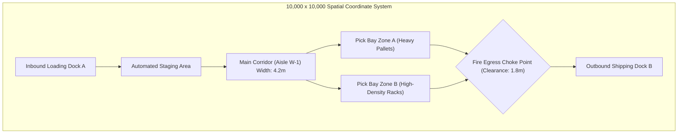

# Module 02: Technical Engineering Artifact Interpretation

## 1. Electrical & Electronics Schematics (IEEE/IEC Standards)

Understanding engineering symbology allows an SME to author problems that expose VLM reasoning failures.

### Standard Schematic Conventions
* **Junctions vs. Crossings**: A solid black dot ($\bullet$) indicates an electrical connection. Crossing lines without a dot represent unjoined, insulated bypass conductors. *Frontier VLMs frequently hallucinate connections at simple crossings.*
* **Power & Ground Rails**: Analog ground ($\triangledown$), digital ground ($\stackrel{\text{DGND}}{\underline{\hspace{3mm}}}$), earth ground ($\frac{\mathbf{\downarrow}}{\mathbf{-}}$), and supply rails ($V_{CC}, V_{DD}, V_{EE}, V_{SS}$).
* **Active Semiconductor Elements**:
  * **BJT**: Base ($B$), Collector ($C$), Emitter ($E$). Arrow pointing outward on emitter = NPN; pointing inward = PNP.
  * **MOSFET**: Gate ($G$), Drain ($D$), Source ($S$), Substrate ($B$). Channel type designated by arrow on source/bulk.
  * **Operational Amplifiers**: Inverting input ($-$), non-inverting input ($+$), output ($V_o$), supply pins ($V^+, V^-$).

```
        Non-Inverting Amplifier                   Inverting Amplifier
              +15V                                       +15V
               |                                          |
             |\\ |                                       |\\ |
  Vin ----+--|+ \\                                   +---|- \\
          |  |  \\------ Vout              Vin -[R1]-+   |  \\------ Vout
          |  |- /                                   |   |  /
          |  |/ |                                   +---|+ /
          |    |                                    |   |/ |
          |   -15V                                 GND    |
          |                                              -15V
          +-[R1]-+                                        |
                 |                                        +-[Rf]-+
                GND                                              |
                                                                Vout
```

---

## 2. Piping & Instrumentation Diagrams (P&ID) — ISA-5.1 Standards

P&IDs represent process piping, vessel equipment, control valves, and electronic/pneumatic feedback loops.

### Instrument Bubble Identification (Tagging Convention)
Instrument tags consist of two parts: a **functional letter code** followed by a **loop number** (e.g., `FIC-101`).

| First Letter (Measured Variable) | Second Letter (Modifier) | Subsequent Letters (Readout/Function) |
| :--- | :--- | :--- |
| **F** — Flow Rate | **D** — Differential | **A** — Alarm (e.g., FAH = Flow Alarm High) |
| **P** — Pressure | **F** — Ratio / Fraction | **C** — Controller |
| **T** — Temperature | **Q** — Totalizer / Integrate | **I** — Indicator |
| **L** — Level | **S** — Safety (e.g., PSV) | **T** — Transmitter |
| **A** — Analysis (pH, gas) | **J** — Power / Scan | **V** — Control Valve |

### Line Type Symbology
* **Major Process Piping**: Solid thick line (`――――――――`).
* **Electrical Signal**: Dashed line (`- - - - - - -`).
* **Pneumatic / Air Supply**: Line with double diagonal slash (`―//―//―//―`).
* **Software / Data Link**: Thin line with hollow bubbles or alternating dashes/dots (`―o―o―o―`).
* **Hydraulic Signal**: Line with periodic `L` marks.

### Valve Fail-Safe Modes
* **Fail Open (FO)**: Actuator arrow points down into valve body. Loss of pneumatic air pressure causes valve spring to force it wide open (used for cooling loops and relief vents).
* **Fail Closed (FC)**: Actuator arrow points away from valve body. Loss of signal shuts the valve completely (used for fuel feed lines and toxic chemical supplies).
* **Fail Locked (FL)**: Valve remains frozen in its last commanded position.

---

## 3. Industrial Floorplans & Warehouse CAD Layouts

Floorplans evaluate spatial, dimensional, and topological navigation constraints.



### Spatial Reasoning Dimensions
1. **Clearance & Collision Checks**: Evaluating whether equipment (forklifts, AGVs, mobile robots) of given dimensions ($L \times W \times H$) can traverse tight aisle radii without violating safety envelopes.
2. **Topological Graph Extraction**: Converting continuous CAD drawings into a directed graph $G = (V, E)$, where vertices $V$ represent aisle intersections/dock doors, and directed edges $E$ represent allowable travel routes.
3. **Choke Point & Bottleneck Identification**: Locating points in the floor plan where capacity drops below inbound arrival rates, causing queue accumulation.
