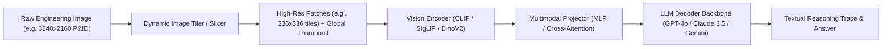

# Module 03: Multimodal AI & Vision-Language Model (VLM) Foundations

## 1. How Vision-Language Models Process Technical Artifacts

To create benchmarks that push the limits of frontier models, an SME must understand the underlying tokenization and vision-language integration pipelines.

### The Visual Tokenization Pipeline
1. **Patch Slicing**: An image of dimensions $W \times H$ is split into discrete non-overlapping or overlapping patches of size $P \times P$ (typically $14 \times 14$ or $16 \times 16$ pixels).
   The number of visual tokens $N$ produced per tile is:
   $$N = \\left(\\frac{W}{P}\\right) \\times \\left(\\frac{H}{P}\\right)$$
2. **Patch Embedding**: Each 2D patch is flattened into a 1D vector and linearly projected into an embedding space of dimension $D$, concatenated with a learnable 2D positional embedding vector.
3. **Cross-Modal Projection**: The visual tokens from the Vision Transformer (ViT) are passed through a 2-layer MLP projection adapter or Perceiver Resampler to match the embedding dimension of the autoregressive language model decoder.

---

## 2. Coordinate Grounding & Spatial Representations

Frontier models (like Gemini 2.5 Pro and GPT-4o) represent spatial locations using **normalised bounding box coordinates**:

$$\\text{bbox} = [y_{\\min}, x_{\\min}, y_{\\max}, x_{\\max}]$$

Where each coordinate is an integer in the range $[0, 1000]$:
$$y_{\\min} = \\left\\lfloor \\frac{Y_{\\min}}{H} \\times 1000 \\right\\rfloor, \\quad x_{\\min} = \\left\\lfloor \\frac{X_{\\min}}{W} \\times 1000 \\right\\rfloor$$

### Why Bounding Box Grounding Matters in Benchmarks
When authoring benchmark items, Innodata requires SMEs to provide verified visual evidence bounding boxes. If a model predicts an answer but attends to the wrong quadrant of a 10-megabyte schematic, it indicates **spurious correlation or lucky guessing** rather than true visual reasoning.

---

## 3. The 5 Signature Failure Modes of Frontier VLMs

| Failure Mode | Mechanism | Vulnerable Engineering Domain |
| :--- | :--- | :--- |
| **1. Topological Disconnection** | VLMs perceive proximity as connectivity. If two lines cross without a junction dot, the model frequently assumes they are electrically or hydraulically coupled. | Circuit schematics, pneumatic control loops, piping networks. |
| **2. Directional Inversion** | Models confuse arrowheads on valve bodies or diodes with the orientation of adjacent text labels, reversing flow direction. | P&IDs (upstream vs. downstream), check valves, hydraulic rams. |
| **3. Small-Text Resolution Loss** | Sub-pixel characters in technical fonts (e.g., distinguishing between `0.01uF` and `0.01mF`, or `10k` and `100k`) get blurred during ViT patch pooling. | Component part numbers, tolerance ratings, wire gauge callouts. |
| **4. Spatial Coordinate Hallucination** | When prompted to locate component tags in crowded diagrams, models hallucinate coordinates biased toward the center of the image canvas. | Plant layouts, high-density PCB silkscreens, architectural blueprints. |
| **5. Multi-Hop Reasoning Drift** | By step 3 or 4 of a complex derivation, the autoregressive language model loses attention over earlier visual tokens, falling back on generic pre-training priors. | Multi-stage op-amps, cascading gear trains, safety interlock chains. |
