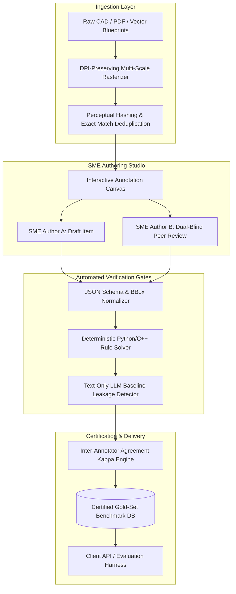

# Module 06: System Design: Scalable Multimodal Benchmark Foundry

## 1. High-Level Architecture Overview

Frontier AI laboratories require hundreds of verified, high-difficulty benchmark items weekly. Below is the system design for an end-to-end benchmark creation, verification, and certification pipeline.

---

## 2. Ingestion & Preprocessing Layer

1. **DPI-Preserving Vector Rasterization**:
   * Industrial drawings (e.g., ANSI E-size, $34 \\times 44$ inches) contain text at 6pt to 10pt font. Standard 72 DPI rendering blurs letters into illegible artifacts.
   * The pipeline rasterizes vector PDFs at **300 to 600 DPI**, yielding master images of $10,000 \\times 13,000$ pixels.
   * High-resolution images are then dynamically tiled into high-resolution overlapping patches for vision encoders while preserving a global downscaled reference.
2. **Perceptual Hashing & Deduplication**:
   * To prevent duplicate items from slightly modified drawing revisions, images are hashed using **Difference Hash (dHash)** and **Wavelet Hash (wHash)**. Pairs with Hamming distance $< 4$ are flagged for review.

---

## 3. The Dual-Blind Quality Assurance & Consensus Protocol

To eliminate individual human bias and guarantee gold-standard accuracy:
1. **Authoring**: SME Author 1 generates the question, selects the visual artifact, identifies the evidence bounding box, and authors the worked proof trace.
2. **Blind Solving**: SME Author 2 is given *only* the problem statement and the visual artifact—the ground-truth answer and proof trace are hidden.
3. **Automated Consensus Verification**:
   * If Author 2's answer matches Author 1's ground truth within the specified tolerance, the item is approved.
   * If there is a discrepancy, the item is automatically routed to a Senior Technical Lead for adjudication.

---

## 4. Inter-Annotator Agreement (IAA) Metrics

Innodata tracks consensus using statistical agreement metrics:

### Cohen's Kappa ($\\kappa$) for Categorical Questions
$$\\kappa = \\frac{p_o - p_e}{1 - p_e}$$
Where:
* $p_o$ is the observed proportional agreement among raters.
* $p_e$ is the hypothetical probability of chance agreement.

| $\\kappa$ Score Range | Interpretation | Quality Action |
| :--- | :--- | :--- |
| **$0.81 - 1.00$** | Almost Perfect Agreement | Direct Certification into Gold Set |
| **$0.61 - 0.80$** | Substantial Agreement | Spot-checked by Lead SME |
| **$< 0.60$** | Inadequate / Ambiguous | Item Rejected or Prompt Rewritten |

### Intersection over Union (IoU) for Bounding Boxes
$$\\text{IoU} = \\frac{\\text{Area of Overlap}}{\\text{Area of Union}} = \\frac{\\text{BBox}_A \\cap \\text{BBox}_B}{\\text{BBox}_A \\cup \\text{BBox}_B}$$
* Benchmark standard: Evidence bounding boxes must achieve **$\\text{IoU} \\ge 0.75$** between dual-blind annotators.

---

## 5. Adversarial Leakage & Difficulty Filtering

Before an item enters the gold set, it undergoes automated red-teaming:
1. **Text-Only Baseline**: The problem statement is fed to state-of-the-art models (GPT-4o, Claude 3.5 Sonnet, Gemini 2.5 Pro) *without the image*. If any model answers correctly with confidence $> 80\\%$, the item is flagged as **leaked** (answer inferable from common sense, physics priors, or prompt text).
2. **Multimodal Baseline**: The problem is fed with the image. If all frontier models fail, the item is classified as **High Frontier Difficulty**.
