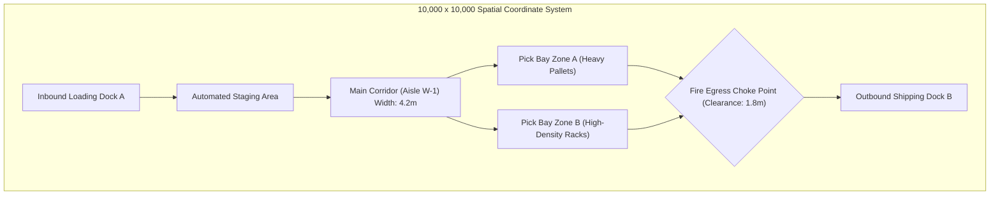
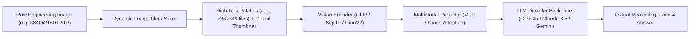
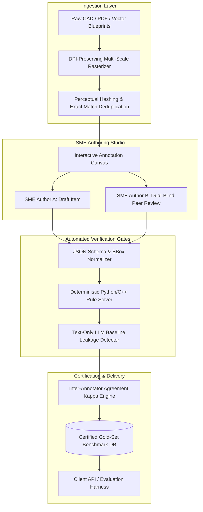

# Innodata India — Complete Interview Preparation Guide

*Target Role: Industrial Technical Visual Reasoning Specialist (Subject Matter Expert)*
*Batch 2027 • NIT Rourkela On-Campus Drive*

---


---

# Module 00: Company & Role Intel

## 1. Executive Intelligence & Business Context

**Innodata Inc. (NASDAQ: INOD)** is a global data engineering and artificial intelligence services company founded in 1990. While historically known for large-scale digital transformation and content authoring, the company underwent a massive strategic pivot starting in 2022–2023 to become a premier **Frontier AI Data Engineering & Evaluation Partner** for top hyperscalers and frontier AI labs (including Google, Microsoft, Meta, Amazon, and Anthropic).

### Why Frontier AI Labs Hire Innodata
Large Language Models (LLMs) and Vision-Language Models (VLMs) have reached near-saturation on generic web-crawled text (Common Crawl, Reddit, Wikipedia) and standard academic benchmarks (GSM8K, HumanEval, MMLU). Frontier labs face critical bottlenecks:
1. **The Multimodal Reasoning Gap**: Models excel at identifying cats or reading simple road signs, but fail catastrophically when asked to reason over complex technical drawings, CAD blueprints, electrical schematics, Piping and Instrumentation Diagrams (P&IDs), and architectural layouts.
2. **The "Googleability" Problem**: Public benchmarks suffer from severe data contamination (models have memorized test sets during pre-training).
3. **The Ground-Truth Necessity**: Supervised Fine-Tuning (SFT) and Reinforcement Learning from Verifiable Rewards (RLVR) require authentic, complex, and provably verifiable domain tasks with step-by-step reasoning proofs.

Innodata builds proprietary evaluation suites, synthetic data pipelines, and gold-standard benchmarks that evaluate models at human-expert capability frontiers.

---

## 2. On-Campus Placement Profile (NIT Rourkela Drive)

| Parameter | Placement Details |
| :--- | :--- |
| **Drive Target** | NIT Rourkela — Batch 2027 (On Campus) |
| **Target Role** | **Industrial Technical Visual Reasoning Specialist (Subject Matter Expert)** |
| **Engagement Model** | **3 Months Internship + PPO Conversion** |
| **Internship Stipend** | **₹60,000 – ₹70,000 / month** (B.Tech / M.Tech / Dual) |
| **PPO Conversion CTC** | **₹10.00 – ₹14.00 LPA** |
| **Job Location** | Noida, Uttar Pradesh (Corporate Delivery Center) |
| **Application Deadline**| 11:59 AM, 21st October 2026 |

---

## 3. The Core Mandate: Industrial Technical Visual Reasoning Specialist

The official Job Description (JD) outlines the core objective:
> *"Develop high-quality multimodal reasoning benchmarks based on authentic industrial and engineering artifacts... evaluate advanced structural, spatial, functional, and analytical reasoning skills... tasks that can only be solved through careful visual interpretation and domain expertise."*

### Key Responsibilities
* **Benchmark Content Development**: Source and synthesize authentic industrial artifacts (CAD models, P&IDs, floor plans, circuit schematics, assembly diagrams, network topologies).
* **Multi-Step Problem Formulation**: Design problems that require multi-hop analytical reasoning, troubleshooting, tolerance verification, and functional flow tracing.
* **Visual Essentiality Constraint**: Ensure the problem cannot be answered from the textual prompt alone or solved via generic web search ("non-Googleable"). The visual artifact must contain non-redundant, indispensable ground truth.
* **Rigorous Proof Trace Authoring**: Write verifiable, step-by-step mathematical, physical, or logical derivations establishing the single correct ground-truth answer.

---

## 4. Selection Process & Hiring Stages


### Stage 1: Diagnostic Assessment (Online)
* **Duration**: 60–90 minutes.
* **Focus**: Logical reasoning, technical reading comprehension, English SOP adherence, diagram interpretation, and basic algorithmic/math skills.
* **Key Filter**: Compliance with instructions. Scores below 90% on guideline adherence are screened out automatically.

### Stage 2: Technical Problem Authoring Round (Practical)
* **Task**: You are given an authentic engineering drawing (e.g., an industrial heat-exchanger P&ID or a multi-stage operational amplifier circuit).
* **Deliverable**:
  1. Author 2 high-difficulty, non-Googleable questions.
  2. Define the exact bounding box / spatial region of interest.
  3. Formulate the single objective ground-truth answer.
  4. Write the complete step-by-step worked derivation with explicit physical/logical laws applied.
  5. Provide 3 plausible distractor answers with explanations of the specific reasoning errors each represents.

### Stage 3: Technical Interview & Candidate Resume Defense
* **Format**: 45–60 minutes 1-on-1 with Senior Technical Lead / AI Engineering Manager.
* **Topics**:
  * Engineering diagram interpretation (ISA-5.1 standards, IEEE circuit symbols, topological graph theory).
  * Multimodal AI architecture basics (Vision Transformers, patch tokenization, spatial grounding).
  * Candidate project grilling: Deep dive into **Uplan** (Adversarial Document Intelligence), **Warehouse PathMapper** (Spatial graph heuristics), and **K-HUKI** (Computer Vision & HOG feature extraction).

### Stage 4: Managerial, HR & SOP Alignment
* **Format**: 30 minutes with HR / Delivery Operations Director.
* **Focus**: Attention to detail, maintaining $\ge 95\%$ accuracy during high-throughput repetitive benchmarking, communication skills, handling ambiguous client prompts, and PPO conversion roadmap.


---

# Module 01: Benchmark & Gold-Set Problem Authoring Protocol

## 1. The Anatomy of an Authentic Industrial Benchmark Item

Every benchmark problem delivered to frontier AI labs follows a strict 4-part schema. Missing any single component invalidates the benchmark item.

```
+--------------------------------------------------------------------------+
| 1. Problem Statement (Clear, unambiguous prompt with visual dependency)  |
+--------------------------------------------------------------------------+
| 2. Authentic Engineering Artifact (CAD, Schematic, P&ID, Floorplan)     |
+--------------------------------------------------------------------------+
| 3. Objective Ground-Truth Answer (Scalar, tag, coordinates, sequence)    |
+--------------------------------------------------------------------------+
| 4. Worked Proof Trace (Step-by-step derivation with domain laws)         |
+--------------------------------------------------------------------------+
```

### The Inviolable Rule: Visual Essentiality
A benchmark item has **zero value** if an advanced model (like GPT-4o or Gemini 2.5 Pro) can answer it using text pre-training alone. 
* **Negative Test (Text-Only Baseline)**: When the prompt is fed to the model *without* the image, the model's accuracy should equal random guessing ($< 25\%$ on multiple choice, $\approx 0\%$ on open-ended numeric).
* **Positive Test (Multimodal Baseline)**: When fed image + prompt, the model must execute visual grounding across multiple sub-elements to derive the answer.

---

## 2. Engineering "Non-Googleable" High-Difficulty Problems

To ensure tasks cannot be solved by reverse-image search or web retrieval:

| Strategy | Mechanism | Example |
| :--- | :--- | :--- |
| **Counterfactual Perturbation** | Introduce a hypothetical fault or state change on an existing diagram. | *"If valve XV-204 is stuck at 30% open while pump P-101B trips, what is the maximum pressure reached at accumulator ACC-01?"* |
| **Multi-Hop Spatial Tracing** | Require following a physical or signal path through 3+ intermediate subsystems. | Tracing a pneumatic signal line through a solenoid, shuttle valve, and pressure regulator to a final control actuator. |
| **Cross-Modal Reconciliation** | Correlating a tabular specification sheet with a physical layout diagram. | Verifying if the breaker rating in Table 2 exceeds the busbar thermal limit depicted in the Single-Line Diagram (SLD). |
| **Topological Inversion** | Asking what component must be modified to achieve an inverted operational state. | Identifying which bypass line allows maintenance on heat exchanger E-102 without shutting down Reactor R-101. |

---

## 3. Full Production Example 1: Electrical Circuit Schematic

### Artifact Context
A multi-stage operational amplifier circuit containing:
* Stage 1: Non-inverting amplifier with gain $A_1 = 1 + \\frac{R_f}{R_1}$, where $R_f = 90\\,\\text{k}\\Omega, R_1 = 10\\,\\text{k}\\Omega$.
* Interstage: Passive low-pass $RC$ filter with $R_2 = 1.59\\,\\text{k}\\Omega, C_1 = 0.1\\,\\mu\\text{F}$.
* Stage 2: Inverting amplifier with gain $A_2 = -\\frac{R_4}{R_3}$, where $R_4 = 50\\,\\text{k}\\Omega, R_3 = 25\\,\\text{k}\\Omega$.
* Supply Rails: $V_{CC} = +15\\,\\text{V}, V_{EE} = -15\\,\\text{V}$. Saturation limits are $\\pm 13.5\\,\\text{V}$.

### Benchmark Item
* **Problem Statement**:
  > *"Examine the two-stage active analog processing circuit in Figure 1. A sinusoidal input signal $v_{in}(t) = 0.5\\sin(2\\pi \\cdot 1000\\,t)\\,\\text{V}$ is applied at terminal $IN$. Accounting for the interstage filter attenuation at frequency $f = 1000\\,\\text{Hz}$ and the op-amp supply saturation rails ($\pm 13.5\\,\\text{V}$), calculate the peak-to-peak output voltage $V_{out(p-p)}$ at terminal $OUT$. Round your answer to two decimal places."*

* **Ground-Truth Derivation (Step-by-Step Proof)**:
  1. **Stage 1 Voltage Gain**:
     $$A_1 = 1 + \\frac{R_f}{R_1} = 1 + \\frac{90\\times 10^3}{10\\times 10^3} = 10.0$$
     The peak voltage at the output of Stage 1 is:
     $$V_{peak,1} = A_1 \\times V_{in,peak} = 10.0 \\times 0.5\\,\\text{V} = 5.0\\,\\text{V}$$
  2. **Interstage Filter Frequency Response**:
     The cutoff frequency $f_c$ of the $RC$ filter is:
     $$f_c = \\frac{1}{2\\pi R_2 C_1} = \\frac{1}{2\\pi \\times 1.59\\times 10^3 \\times 0.1\\times 10^{-6}} \\approx 1000.9\\,\\text{Hz} \\approx 1000\\,\\text{Hz}$$
     At frequency $f = 1000\\,\\text{Hz}$, the transfer function magnitude $|H(f)|$ is:
     $$|H(f)| = \\frac{1}{\\sqrt{1 + \\left(\\frac{f}{f_c}\\right)^2}} = \\frac{1}{\\sqrt{1 + 1^2}} = \\frac{1}{\\sqrt{2}} \\approx 0.7071$$
     Voltage arriving at Stage 2 input:
     $$V_{peak,2\\_in} = V_{peak,1} \\times |H(1000)| = 5.0\\,\\text{V} \\times 0.7071 = 3.5355\\,\\text{V}$$
  3. **Stage 2 Voltage Gain**:
     $$A_2 = -\\frac{R_4}{R_3} = -\\frac{50\\times 10^3}{25\\times 10^3} = -2.0$$
     Unclipped output peak voltage:
     $$V_{out,peak} = |A_2| \\times V_{peak,2\\_in} = 2.0 \\times 3.5355\\,\\text{V} = 7.071\\,\\text{V}$$
  4. **Saturation Check**:
     $V_{out,peak} = 7.071\\,\\text{V} < V_{sat} (13.5\\,\\text{V})$. No clipping occurs.
  5. **Peak-to-Peak Calculation**:
     $$V_{out(p-p)} = 2 \\times V_{out,peak} = 2 \\times 7.071\\,\\text{V} = 14.14\\,\\text{V}$$
* **Objective Answer**: `14.14 V` (Tolerance: $[14.10, 14.18]$).

---

## 4. Full Production Example 2: Chemical Process P&ID

### Artifact Context
A distillation column overhead reflux accumulator system with automated pressure relief, bypass throttling, and emergency shutoff valves (ESDV).

### Benchmark Item
* **Problem Statement**:
  > *"Refer to the overhead condenser piping loop in P&ID Sheet 4B. Pressure transmitter PT-304 signals high-pressure alarm PAH-304 at $6.8\\,\\text{bar}$. According to the interlock logic diagram, which combination of automatic valves will immediately change state, and what is the resulting flow destination of the volatile vapor stream?"*

* **Ground-Truth Derivation**:
  1. Inspect instrument bubble `PT-304` on reflux drum `D-301`. Follow electrical signal line (dashed line) to SIS logic solver `I-304`.
  2. Logic solver `I-304` triggers output interlock `I-04`:
     * Energizes solenoid valve `SOV-304A` to vent air from pneumatic actuator on fail-closed control valve `PCV-304`.
     * Valve `PCV-304` transitions to **100% OPEN** within 1.5 seconds.
     * De-energizes solenoid valve `SOV-302` on suction of booster pump `P-302A/B`, tripping both motors.
  3. Trace the discharge piping downstream of `PCV-304`: Line `6"-HC-3041-A1A` leads directly to the **Low-Pressure Flare Header (FL-01)**, bypassing the tertiary absorption column.
* **Objective Answer**: `PCV-304 opens; P-302A/B trip; flow routes to Low-Pressure Flare Header FL-01`.


---

# Module 02: Technical Engineering Artifact Interpretation

## 1. Electrical & Electronics Schematics (IEEE/IEC Standards)

Understanding engineering symbology allows an SME to author problems that expose VLM reasoning failures.

### Standard Schematic Conventions
* **Junctions vs. Crossings**: A solid black dot ($\bullet$) indicates an electrical connection. Crossing lines without a dot represent unjoined, insulated bypass conductors. *Frontier VLMs frequently hallucinate connections at simple crossings.*
* **Power & Ground Rails**: Analog ground ($\triangledown$), digital ground ($\stackrel{\text{DGND}}{\underline{\hspace{3mm}}}$), earth ground ($\frac{\mathbf{\downarrow}}{\mathbf{-}}$), and supply rails ($V_{CC}, V_{DD}, V_{EE}, V_{SS}$).
* **Active Semiconductor Elements**:
  * **BJT**: Base ($B$), Collector ($C$), Emitter ($E$). Arrow pointing outward on emitter = NPN; pointing inward = PNP.
  * **MOSFET**: Gate ($G$), Drain ($D$), Source ($S$), Substrate ($B$). Channel type designated by arrow on source/bulk.
  * **Operational Amplifiers**: Inverting input ($-$), non-inverting input ($+$), output ($V_o$), supply pins ($V^+, V^-$).

```
        Non-Inverting Amplifier                   Inverting Amplifier
              +15V                                       +15V
               |                                          |
             |\\ |                                       |\\ |
  Vin ----+--|+ \\                                   +---|- \\
          |  |  \\------ Vout              Vin -[R1]-+   |  \\------ Vout
          |  |- /                                   |   |  /
          |  |/ |                                   +---|+ /
          |    |                                    |   |/ |
          |   -15V                                 GND    |
          |                                              -15V
          +-[R1]-+                                        |
                 |                                        +-[Rf]-+
                GND                                              |
                                                                Vout
```

---

## 2. Piping & Instrumentation Diagrams (P&ID) — ISA-5.1 Standards

P&IDs represent process piping, vessel equipment, control valves, and electronic/pneumatic feedback loops.

### Instrument Bubble Identification (Tagging Convention)
Instrument tags consist of two parts: a **functional letter code** followed by a **loop number** (e.g., `FIC-101`).

| First Letter (Measured Variable) | Second Letter (Modifier) | Subsequent Letters (Readout/Function) |
| :--- | :--- | :--- |
| **F** — Flow Rate | **D** — Differential | **A** — Alarm (e.g., FAH = Flow Alarm High) |
| **P** — Pressure | **F** — Ratio / Fraction | **C** — Controller |
| **T** — Temperature | **Q** — Totalizer / Integrate | **I** — Indicator |
| **L** — Level | **S** — Safety (e.g., PSV) | **T** — Transmitter |
| **A** — Analysis (pH, gas) | **J** — Power / Scan | **V** — Control Valve |

### Line Type Symbology
* **Major Process Piping**: Solid thick line (`――――――――`).
* **Electrical Signal**: Dashed line (`- - - - - - -`).
* **Pneumatic / Air Supply**: Line with double diagonal slash (`―//―//―//―`).
* **Software / Data Link**: Thin line with hollow bubbles or alternating dashes/dots (`―o―o―o―`).
* **Hydraulic Signal**: Line with periodic `L` marks.

### Valve Fail-Safe Modes
* **Fail Open (FO)**: Actuator arrow points down into valve body. Loss of pneumatic air pressure causes valve spring to force it wide open (used for cooling loops and relief vents).
* **Fail Closed (FC)**: Actuator arrow points away from valve body. Loss of signal shuts the valve completely (used for fuel feed lines and toxic chemical supplies).
* **Fail Locked (FL)**: Valve remains frozen in its last commanded position.

---

## 3. Industrial Floorplans & Warehouse CAD Layouts

Floorplans evaluate spatial, dimensional, and topological navigation constraints.



### Spatial Reasoning Dimensions
1. **Clearance & Collision Checks**: Evaluating whether equipment (forklifts, AGVs, mobile robots) of given dimensions ($L \times W \times H$) can traverse tight aisle radii without violating safety envelopes.
2. **Topological Graph Extraction**: Converting continuous CAD drawings into a directed graph $G = (V, E)$, where vertices $V$ represent aisle intersections/dock doors, and directed edges $E$ represent allowable travel routes.
3. **Choke Point & Bottleneck Identification**: Locating points in the floor plan where capacity drops below inbound arrival rates, causing queue accumulation.


---

# Module 03: Multimodal AI & Vision-Language Model (VLM) Foundations

## 1. How Vision-Language Models Process Technical Artifacts

To create benchmarks that push the limits of frontier models, an SME must understand the underlying tokenization and vision-language integration pipelines.



### The Visual Tokenization Pipeline
1. **Patch Slicing**: An image of dimensions $W \times H$ is split into discrete non-overlapping or overlapping patches of size $P \times P$ (typically $14 \times 14$ or $16 \times 16$ pixels).
   The number of visual tokens $N$ produced per tile is:
   $$N = \\left(\\frac{W}{P}\\right) \\times \\left(\\frac{H}{P}\\right)$$
2. **Patch Embedding**: Each 2D patch is flattened into a 1D vector and linearly projected into an embedding space of dimension $D$, concatenated with a learnable 2D positional embedding vector.
3. **Cross-Modal Projection**: The visual tokens from the Vision Transformer (ViT) are passed through a 2-layer MLP projection adapter or Perceiver Resampler to match the embedding dimension of the autoregressive language model decoder.

---

## 2. Coordinate Grounding & Spatial Representations

Frontier models (like Gemini 2.5 Pro and GPT-4o) represent spatial locations using **normalised bounding box coordinates**:

$$\\text{bbox} = [y_{\\min}, x_{\\min}, y_{\\max}, x_{\\max}]$$

Where each coordinate is an integer in the range $[0, 1000]$:
$$y_{\\min} = \\left\\lfloor \\frac{Y_{\\min}}{H} \\times 1000 \\right\\rfloor, \\quad x_{\\min} = \\left\\lfloor \\frac{X_{\\min}}{W} \\times 1000 \\right\\rfloor$$

### Why Bounding Box Grounding Matters in Benchmarks
When authoring benchmark items, Innodata requires SMEs to provide verified visual evidence bounding boxes. If a model predicts an answer but attends to the wrong quadrant of a 10-megabyte schematic, it indicates **spurious correlation or lucky guessing** rather than true visual reasoning.

---

## 3. The 5 Signature Failure Modes of Frontier VLMs

| Failure Mode | Mechanism | Vulnerable Engineering Domain |
| :--- | :--- | :--- |
| **1. Topological Disconnection** | VLMs perceive proximity as connectivity. If two lines cross without a junction dot, the model frequently assumes they are electrically or hydraulically coupled. | Circuit schematics, pneumatic control loops, piping networks. |
| **2. Directional Inversion** | Models confuse arrowheads on valve bodies or diodes with the orientation of adjacent text labels, reversing flow direction. | P&IDs (upstream vs. downstream), check valves, hydraulic rams. |
| **3. Small-Text Resolution Loss** | Sub-pixel characters in technical fonts (e.g., distinguishing between `0.01uF` and `0.01mF`, or `10k` and `100k`) get blurred during ViT patch pooling. | Component part numbers, tolerance ratings, wire gauge callouts. |
| **4. Spatial Coordinate Hallucination** | When prompted to locate component tags in crowded diagrams, models hallucinate coordinates biased toward the center of the image canvas. | Plant layouts, high-density PCB silkscreens, architectural blueprints. |
| **5. Multi-Hop Reasoning Drift** | By step 3 or 4 of a complex derivation, the autoregressive language model loses attention over earlier visual tokens, falling back on generic pre-training priors. | Multi-stage op-amps, cascading gear trains, safety interlock chains. |


---

# Module 04: Production Python & C++ Verifiers & Test Harnesses

## 1. Automated Schema Validation for Benchmark Items

Innodata's data pipeline enforces programmatic quality gates. Below is the production Python validator verifying benchmark integrity, bounding box normalization, and proof completeness.

```python
import json
import re
from typing import Dict, Any, List

class BenchmarkItemValidator:
    REQUIRED_FIELDS = ["item_id", "domain", "problem_statement", "visual_artifact", "ground_truth", "worked_solution"]
    
    @staticmethod
    def validate_item(item: Dict[str, Any]) -> List[str]:
        errors = []
        # 1. Structural schema completeness
        for field in BenchmarkItemValidator.REQUIRED_FIELDS:
            if field not in item:
                errors.append(f"Missing required field: '{field}'")
                
        if errors:
            return errors
            
        # 2. Visual essentiality check (heuristic keyword detection)
        prompt = item["problem_statement"]
        if len(prompt.strip()) < 30:
            errors.append("Problem statement too short (<30 chars)")
            
        # 3. Ground truth formatting
        gt = item["ground_truth"]
        if not gt.get("answer"):
            errors.append("Ground truth 'answer' cannot be empty")
            
        # 4. Bounding box normalization check [ymin, xmin, ymax, xmax] in [0, 1000]
        bboxes = item["visual_artifact"].get("evidence_bboxes", [])
        if not bboxes:
            errors.append("At least one evidence bounding box is required")
        for idx, bbox in enumerate(bboxes):
            if len(bbox) != 4:
                errors.append(f"BBox {idx} must have 4 coordinates [ymin, xmin, ymax, xmax]")
                continue
            ymin, xmin, ymax, xmax = bbox
            if not (0 <= ymin < ymax <= 1000 and 0 <= xmin < xmax <= 1000):
                errors.append(f"BBox {idx} coordinates out of range [0, 1000] or invalid: {bbox}")
                
        # 5. Worked solution step verification
        solution = item["worked_solution"]
        steps = solution.get("steps", [])
        if len(steps) < 2:
            errors.append(f"Worked solution must have at least 2 structured steps; found {len(steps)}")
            
        return errors

# Production test run
sample_item = {
    "item_id": "INNO-ELEC-2026-001",
    "domain": "Electrical Engineering",
    "problem_statement": "Examine the active analog filter in Figure 1. Given Vin(t) = 0.5sin(2000pi*t) V, determine Vout(p-p).",
    "visual_artifact": {
        "file_name": "schematic_dual_opamp.png",
        "evidence_bboxes": [[150, 220, 480, 560], [510, 600, 890, 920]]
    },
    "ground_truth": {
        "answer": "14.14 V",
        "tolerance_range": [14.10, 14.18],
        "type": "numeric_with_unit"
    },
    "worked_solution": {
        "steps": [
            "Compute Stage 1 gain A1 = 1 + Rf/R1 = 1 + 90k/10k = 10.0.",
            "Calculate interstage filter attenuation at f=1000Hz: |H| = 1/sqrt(2) = 0.7071.",
            "Compute Stage 2 inverting gain A2 = -R4/R3 = -50k/25k = -2.0.",
            "Verify saturation: Vpeak = 10 * 0.5 * 0.7071 * 2 = 7.071V < 13.5V.",
            "Calculate peak-to-peak: 2 * 7.071V = 14.14V."
        ],
        "final_proof": "Vout(p-p) = 14.14 V"
    }
}

validator = BenchmarkItemValidator()
errs = validator.validate_item(sample_item)
print("Validation Result:", "PASSED" if not errs else errs)
```

---

## 2. Python Topological Network Verifier (NetworkX)

Engineering schematics and P&IDs can be programmatically verified by modeling the components as an attributed directed graph.

```python
import networkx as nx

def build_pid_hydraulic_network():
    G = nx.DiGraph()
    
    # Add equipment nodes
    G.add_node("R-101", type="Reactor", state="Active")
    G.add_node("P-101A", type="Pump", state="Running", rated_flow=120)
    G.add_node("P-101B", type="Pump", state="Standby", rated_flow=120)
    G.add_node("V-101", type="ManualValve", state="Open")
    G.add_node("FCV-102", type="ControlValve", state="50% Open")
    G.add_node("V-103", type="ManualValve", state="Closed") # Bypass
    G.add_node("E-101", type="HeatExchanger", state="Normal")
    G.add_node("D-102", type="StorageDrum", state="Active")
    
    # Add piping connections (Edges with line specs)
    G.add_edge("R-101", "V-101", pipe_id="6-P-1001", diameter_in=6)
    G.add_edge("V-101", "P-101A", pipe_id="6-P-1002A", diameter_in=6)
    G.add_edge("V-101", "P-101B", pipe_id="6-P-1002B", diameter_in=6)
    G.add_edge("P-101A", "FCV-102", pipe_id="4-P-1003", diameter_in=4)
    G.add_edge("FCV-102", "E-101", pipe_id="4-P-1004", diameter_in=4)
    G.add_edge("P-101A", "V-103", pipe_id="4-P-BYPASS", diameter_in=4)
    G.add_edge("V-103", "E-101", pipe_id="4-P-BYPASS_RETURN", diameter_in=4)
    G.add_edge("E-101", "D-102", pipe_id="6-P-1005", diameter_in=6)
    
    return G

def find_active_flow_paths(G, source, target):
    \"\"\"Finds all paths where all intermediate valves are Open.\"\"\"
    valid_paths = []
    for path in nx.all_simple_paths(G, source, target):
        path_open = True
        for node in path:
            state = G.nodes[node].get("state", "")
            if state == "Closed" or state == "Standby":
                path_open = False
                break
        if path_open:
            valid_paths.append(path)
    return valid_paths

net = build_pid_hydraulic_network()
active_paths = find_active_flow_paths(net, "R-101", "D-102")
print("Verified Active Process Stream:", active_paths)
```

---

## 3. High-Performance C++ Geometric & Graph Engine

In high-throughput benchmark auditing, continuous CAD bounding boxes and spatial adjacency graphs are checked using C++ for sub-millisecond execution.

```cpp
#include <iostream>
#include <vector>
#include <string>
#include <queue>
#include <algorithm>

struct BoundingBox {
    int ymin, xmin, ymax, xmax;
    
    bool intersects(const BoundingBox& o) const {
        return !(xmin >= o.xmax || xmax <= o.xmin || ymin >= o.ymax || ymax <= o.ymin);
    }
    
    double intersectionOverUnion(const BoundingBox& o) const {
        int interX1 = std::max(xmin, o.xmin);
        int interY1 = std::max(ymin, o.ymin);
        int interX2 = std::min(xmax, o.xmax);
        int interY2 = std::min(ymax, o.ymax);
        
        if (interX2 <= interX1 || interY2 <= interY1) return 0.0;
        double interArea = (interX2 - interX1) * (interY2 - interY1);
        double areaA = (xmax - xmin) * (ymax - ymin);
        double areaB = (o.xmax - o.xmin) * (o.ymax - o.ymin);
        return interArea / (areaA + areaB - interArea);
    }
};

class SchematicGraph {
public:
    int numVertices;
    std::vector<std::vector<int>> adj;
    std::vector<std::string> componentNames;

    SchematicGraph(int n) : numVertices(n), adj(n), componentNames(n) {}

    void addConnection(int u, int v) {
        adj[u].push_back(v);
        adj[v].push_back(u); // Bidirectional electrical trace
    }

    bool isElectricallyConnected(int start, int end) {
        std::vector<bool> visited(numVertices, false);
        std::queue<int> q;
        q.push(start);
        visited[start] = true;

        while (!q.empty()) {
            int curr = q.front();
            q.pop();
            if (curr == end) return true;

            for (int neighbor : adj[curr]) {
                if (!visited[neighbor]) {
                    visited[neighbor] = true;
                    q.push(neighbor);
                }
            }
        }
        return false;
    }
};

int main() {
    BoundingBox pred{100, 100, 300, 300};
    BoundingBox groundTruth{120, 110, 310, 290};
    std::cout << "BBox IoU Score: " << pred.intersectionOverUnion(groundTruth) << "\\n";

    SchematicGraph sg(5);
    sg.addConnection(0, 1); // Vin -> R1
    sg.addConnection(1, 2); // R1 -> OpAmp Input
    sg.addConnection(2, 3); // OpAmp Output -> Filter
    sg.addConnection(3, 4); // Filter -> Vout

    std::cout << "Trace Vin to Vout Connected: " 
              << (sg.isElectricallyConnected(0, 4) ? "YES" : "NO") << "\\n";
    return 0;
}
```


---

# Module 05: Candidate Resume Grilling & Defensive Strategies

## 1. Candidate Background Defense: M.Tech Signal Processing + B.Tech CSE

As **Adarsh Saurabh** (Roll: `225EC6021`), you hold an exceptionally synergistic combination:
* **M.Tech in Signal and Image Processing (NIT Rourkela, 2025–2027, CGPA: 8.28)**: Provides rigorous mathematical grounding in spatial frequency, 2D continuous/discrete convolution, image gradient orientation, Fourier/Laplace analysis, and structural pattern recognition.
* **B.Tech in Computer Science and Engineering (GGU Bilaspur, 2020–2024, CGPA: 8.5)**: Provides algorithmic optimization, data structures, graph theory, multi-threading, and systems engineering.

### Expected Strategic Trap: "Why apply for Visual Reasoning SME instead of traditional SWE?"
* **Flawed Answer**: *"I just need an internship and this role looked interesting."* (Instant rejection).
* **Winning Pivot**:
  > *"Traditional SWE builds CRUD pipelines; the frontier bottleneck of modern AI is evaluation and multimodal reasoning. In this role, my Signal and Image Processing research background at NIT Rourkela allows me to dissect complex engineering artifacts—schematics, spatial diagrams, and CAD drawings—at the mathematical and structural level. Combined with my B.Tech CSE foundation, I don't just solve problems manually; I can design deterministic programmatic verifiers and synthetic evaluation harnesses that scale Innodata's benchmark throughput for frontier labs."*

---

## 2. Project Defense 1: Uplan — Adversarial Document Intelligence Pipeline

### The Project Reality
* **Stack**: Python, Gemini API, LangGraph, Streamlit.
* **Core Achievement**: Architected an adversarial multi-agent workflow in LangGraph utilizing Gemini 2.5 Pro specialists to check visa document coherence; reduced manual verification workload by 85% with detailed failure rebuttal generation.
* **Key Innovation**: Designed structural encoding system using Gemini 2.0 Flash to compile page-level document metadata into a typed semantic graph (98% token compression) and integrated a zero-hallucination mathematical rule check engine.

### Interview Grilling & Defense
* **Q: "How does Uplan's typed semantic graph translate to Innodata's visual benchmark tasks?"**
  * **Defense**: *"In Uplan, raw document images are filled with high-dimensional noise. Rather than feeding raw OCR dumps into a model, I engineered a structural encoding pipeline that translated visual geometry (headers, signatures, stamps, tables) into typed semantic graph nodes with spatial relational edges (e.g., `ABOVE`, `CONTAINS`, `CROSS_REFERENCES`). This exact paradigm is required when converting CAD blueprints or P&IDs into verified ground-truth DAGs for multimodal AI benchmarking."*
* **Q: "What do you mean by 'zero-hallucination mathematical rule check engine'?"**
  * **Defense**: *"LLMs are notorious for arithmetic drift when computing date durations or balance reconciliations. In Uplan, I decoupled reasoning from calculation: the language model was strictly restricted to extracting symbolic variables into a typed Pydantic schema, while an external deterministic Python rule engine executed all mathematical validations. In benchmark authoring, this ensures that the ground-truth worked proof trace is mathematically irrefutable."*

---

## 3. Project Defense 2: Warehouse PathMapper (IBYD Technology)

### The Project Reality
* **Stack**: Python, Algorithms, Data Analysis.
* **Core Achievement**: Delivered a dynamic warehouse mapping solution as a freelance engagement, translating operational pathfinding needs into a heuristic-based routing system. Scaled the engine to warehouses as large as $10,000 \times 10,000$ units, computing optimal paths through 10,000+ locations in under 0.5s on a standard CPU.

### Interview Grilling & Defense
* **Q: "Innodata evaluates CAD floorplans and architectural layouts. How did you model physical constraints in PathMapper?"**
  * **Defense**: *"A continuous $10,000 \times 10,000$ coordinate grid is too computationally expensive for exhaustive search ($10^8$ cells). I abstracted the physical floorplan into a sparse topological adjacency graph where only allowable transit corridors, rack intersections, and docking gates became vertices. Obstacles, one-way aisle rules, and AGV turning radius clearances were encoded as dynamic edge weights and directional constraints. When benchmarking VLMs on floorplans, this allows me to instantly test whether a model's predicted navigation path violates physical wall boundaries."*

---

## 4. Project Defense 3: K-HUKI (Unsupervised Keyframe Identifier)

### The Project Reality
* **Stack**: Python, Computer Vision, Machine Learning.
* **Core Achievement**: Built keyframe extraction system with HOG (Histogram of Oriented Gradients) features and unsupervised learning achieving 96.45% accuracy; developed preprocessing architecture 11x faster than ResNet-based approaches.

### Interview Grilling & Defense
* **Q: "Why did you choose HOG features over deep learning embeddings like ResNet or ViT?"**
  * **Defense**: *"Deep neural networks like ResNet-50 require heavy matrix multiplications and GPU acceleration, introducing massive latency. HOG captures edge and corner structural orientations directly from image gradient vectors ($\nabla I_x, \nabla I_y$). In industrial diagrams, line geometry and orientation matter far more than texture or semantic color. HOG provided 11x faster preprocessing with zero GPU dependency while capturing the structural contours of the visual artifact with 96.45% accuracy."*


---

# Module 06: System Design: Scalable Multimodal Benchmark Foundry

## 1. High-Level Architecture Overview

Frontier AI laboratories require hundreds of verified, high-difficulty benchmark items weekly. Below is the system design for an end-to-end benchmark creation, verification, and certification pipeline.



---

## 2. Ingestion & Preprocessing Layer

1. **DPI-Preserving Vector Rasterization**:
   * Industrial drawings (e.g., ANSI E-size, $34 \\times 44$ inches) contain text at 6pt to 10pt font. Standard 72 DPI rendering blurs letters into illegible artifacts.
   * The pipeline rasterizes vector PDFs at **300 to 600 DPI**, yielding master images of $10,000 \\times 13,000$ pixels.
   * High-resolution images are then dynamically tiled into high-resolution overlapping patches for vision encoders while preserving a global downscaled reference.
2. **Perceptual Hashing & Deduplication**:
   * To prevent duplicate items from slightly modified drawing revisions, images are hashed using **Difference Hash (dHash)** and **Wavelet Hash (wHash)**. Pairs with Hamming distance $< 4$ are flagged for review.

---

## 3. The Dual-Blind Quality Assurance & Consensus Protocol

To eliminate individual human bias and guarantee gold-standard accuracy:
1. **Authoring**: SME Author 1 generates the question, selects the visual artifact, identifies the evidence bounding box, and authors the worked proof trace.
2. **Blind Solving**: SME Author 2 is given *only* the problem statement and the visual artifact—the ground-truth answer and proof trace are hidden.
3. **Automated Consensus Verification**:
   * If Author 2's answer matches Author 1's ground truth within the specified tolerance, the item is approved.
   * If there is a discrepancy, the item is automatically routed to a Senior Technical Lead for adjudication.

---

## 4. Inter-Annotator Agreement (IAA) Metrics

Innodata tracks consensus using statistical agreement metrics:

### Cohen's Kappa ($\\kappa$) for Categorical Questions
$$\\kappa = \\frac{p_o - p_e}{1 - p_e}$$
Where:
* $p_o$ is the observed proportional agreement among raters.
* $p_e$ is the hypothetical probability of chance agreement.

| $\\kappa$ Score Range | Interpretation | Quality Action |
| :--- | :--- | :--- |
| **$0.81 - 1.00$** | Almost Perfect Agreement | Direct Certification into Gold Set |
| **$0.61 - 0.80$** | Substantial Agreement | Spot-checked by Lead SME |
| **$< 0.60$** | Inadequate / Ambiguous | Item Rejected or Prompt Rewritten |

### Intersection over Union (IoU) for Bounding Boxes
$$\\text{IoU} = \\frac{\\text{Area of Overlap}}{\\text{Area of Union}} = \\frac{\\text{BBox}_A \\cap \\text{BBox}_B}{\\text{BBox}_A \\cup \\text{BBox}_B}$$
* Benchmark standard: Evidence bounding boxes must achieve **$\\text{IoU} \\ge 0.75$** between dual-blind annotators.

---

## 5. Adversarial Leakage & Difficulty Filtering

Before an item enters the gold set, it undergoes automated red-teaming:
1. **Text-Only Baseline**: The problem statement is fed to state-of-the-art models (GPT-4o, Claude 3.5 Sonnet, Gemini 2.5 Pro) *without the image*. If any model answers correctly with confidence $> 80\\%$, the item is flagged as **leaked** (answer inferable from common sense, physics priors, or prompt text).
2. **Multimodal Baseline**: The problem is fed with the image. If all frontier models fail, the item is classified as **High Frontier Difficulty**.


---

# Module 07: Managerial, HR Alignment & Evaluation Ethics

## 1. Navigating Guideline Ambiguity & SOP Compliance

Innodata's client contracts stipulate **$\\ge 95\\%$ precision thresholds**. A single hallucinated metric or improperly tagged bounding box can degrade an entire batch.

### Scenario 1: Conflicting Client Guidelines
* **Interviewer**: *"Suppose the client SOP says 'Extract all valve tags including manual isolation valves', but another section states 'Exclude inline manual bypass valves'. You are on a tight deadline. How do you resolve this?"*
* **Flawed Answer**: *"I will use my best judgment and skip them to finish faster."*
* **Winning Response**:
  > *"I never guess or make unilateral assumptions on ambiguous specifications, as that introduces systematic noise into the training data. My protocol is:
  > 1. Document the exact conflict with screenshot examples and page numbers from the SOP.
  > 2. Create an edge-case query ticket in the internal tracker and notify the project lead.
  > 3. Temporarily tag those items under a segregated 'Pending SOP Clarification' status so production is not blocked.
  > 4. Once clarified, apply the standardized resolution consistently across all affected items."*

---

## 2. Maintaining Quality & Avoiding Fatigue Under Repetition

* **Interviewer**: *"Benchmarking hundreds of technical schematics daily can become repetitive. How do you maintain 95%+ accuracy without burning out?"*
* **Winning Response**:
  > *"I maintain precision through structured process automation and deliberate time-boxing:
  > 1. **Checklist Discipline**: I follow an invariant 4-point verification checklist for every item: visual essentiality $\\to$ coordinate normalization $\\to$ domain formula check $\\to$ distractor plausibility.
  > 2. **Automated Sanity Scripts**: I write personal validation scripts (like the Python schema validator I developed) to catch formatting and bounding box errors before final submission.
  > 3. **Time-Boxing (Pomodoro Technique)**: High-concentration analytical work is divided into 50-minute focused review blocks with 10-minute mental resets to prevent visual fatigue."*

---

## 3. High-Impact Behavioral Questions & Winning Answers

### Q1: "Why Innodata India instead of a traditional software product firm?"
* **Winning Response**:
  > *"Traditional product engineering develops application interfaces; AI data engineering shapes the cognitive reasoning capabilities of the world's most advanced foundation models. Innodata is at the absolute epicenter of this revolution, partnering directly with leading hyperscalers. As an M.Tech in Signal Processing with a B.Tech in CSE, my passion is at the intersection of complex visual signals and algorithmic verification. This role gives me hands-on impact in setting the frontier benchmarks for multimodal intelligence."*

### Q2: "What is your roadmap for converting the 3-month internship into a full-time PPO?"
* **Winning Response**:
  > *"My objective is to become a top-tier core contributor from Day 1:
  > * **Month 1 (Mastery & SOP Excellence)**: Achieve zero-error compliance on all client annotation guidelines and exceed the daily benchmarking quota with $100\\%$ on-time delivery.
  > * **Month 2 (Tooling & Acceleration)**: Implement programmatic verifiers and Python preprocessing scripts to help team members automate repetitive validation checks.
  > * **Month 3 (Complex Authoring & Leadership)**: Take ownership of high-difficulty industrial domains (multimodal control systems, complex CAD floorplans) and mentor newer associates to drive team-wide throughput."*


---

# Module 08: Rapid Recall CheatSheet & Formula Reference

## 1. ISA-5.1 P&ID Letter Identification Table

| First Letter (Variable) | Meaning | Second Letter (Modifier) | Subsequent Letters (Function) |
| :---: | :--- | :---: | :--- |
| **A** | Analysis (pH, O2, Gas) | **D** (Differential) | **A** (Alarm) |
| **F** | Flow Rate | **F** (Ratio) | **C** (Controller) |
| **L** | Level (Liquid / Solid) | **Q** (Totalize / Integrate) | **I** (Indicator) |
| **P** | Pressure | **S** (Safety / Interlock) | **T** (Transmitter) |
| **T** | Temperature | **—** | **V** (Control Valve) |

*Examples*:
* `PT-101`: Pressure Transmitter
* `FIC-204`: Flow Indicating Controller
* `PSV-301`: Pressure Safety Valve
* `PAH-102`: Pressure Alarm High

---

## 2. Core Electrical Circuit Formulas

### Inverting Operational Amplifier
$$V_{out} = -\\frac{R_f}{R_{in}} \\cdot V_{in}$$

### Non-Inverting Operational Amplifier
$$V_{out} = \\left(1 + \\frac{R_f}{R_1}\\right) \\cdot V_{in}$$

### First-Order Passive Low-Pass RC Filter
* **Cutoff Frequency**:
  $$f_c = \\frac{1}{2\\pi R C}$$
* **Gain Magnitude at Frequency $f$**:
  $$|H(f)| = \\frac{1}{\\sqrt{1 + \\left(\\frac{f}{f_c}\\right)^2}}$$

---

## 3. Mathematical & Evaluation Formulas

### Bounding Box Normalisation ($[0, 1000]$ Coordinate Space)
$$y_{\\min} = \\left\\lfloor \\frac{Y_{\\min}}{H} \\times 1000 \\right\\rfloor, \\quad x_{\\min} = \\left\\lfloor \\frac{X_{\\min}}{W} \\times 1000 \\right\\rfloor$$

### Intersection over Union (IoU)
$$\\text{IoU} = \\frac{\\text{Area}(A \\cap B)}{\\text{Area}(A \\cup B)}$$

### Cohen's Kappa (Inter-Annotator Agreement)
$$\\kappa = \\frac{p_o - p_e}{1 - p_e}$$

### Vision Transformer (ViT) Patch Count
$$N = \\left\\lceil \\frac{W}{P} \\right\\rceil \\times \\left\\lceil \\frac{H}{P} \\right\\rceil$$

---

## 4. The 10-Point Benchmark Submission Audit Checklist

- [ ] **1. Visual Essentiality**: Can this question be answered without viewing the image? If yes $\\to$ **REWRITE**.
- [ ] **2. Non-Googleable**: Are the specific diagram labels and numerical values non-retrievable online?
- [ ] **3. Bounding Box Precision**: Does the evidence bounding box tightly encompass the target artifact without excess padding?
- [ ] **4. Normalization Range**: Are all coordinates strictly integers between $0$ and $1000$?
- [ ] **5. Unambiguous Ground Truth**: Is the answer definitive with explicit units and tolerance bounds?
- [ ] **6. Step-by-Step Proof**: Does the worked solution cite explicit physical/mathematical laws at every step?
- [ ] **7. Plausible Distractors**: Do incorrect options correspond to common VLM failure modes (e.g., directional inversion, OCR blur)?
- [ ] **8. Image Resolution**: Is the visual artifact rendered at $\\ge 300\\,\\text{DPI}$ without compression artifacts?
- [ ] **9. Guideline Compliance**: Does the item adhere to all client-specific nomenclature rules?
- [ ] **10. Independent Solvability**: Can a peer SME arrive at the exact same answer independently?


---

# 3-Day Intensive Selection Roadmap

A structured preparation schedule designed to master the Innodata Industrial Technical Visual Reasoning recruitment process.

---

## Day 1: Foundation & Artifact Symbology Mastery
* **Focus**: Memorizing engineering standards and visual reasoning mechanics.
* **Modules to Cover**:
  * [Module 00: Company & Role Intel](00_START_HERE.html) — Understand Innodata's business model and the 3M+PPO engagement structure.
  * [Module 01: Benchmark & Gold-Set Design](01_Benchmark_Creation_Protocol.html) — Internalize the 4-part benchmark anatomy and visual essentiality rule.
  * [Module 02: Schematics, P&ID & Layouts](02_Technical_Engineering_Artifacts.html) — Master ISA-5.1 P&ID letter codes and IEEE circuit symbols.
* **Practical Exercise**: Pick an electrical schematic and a P&ID from Google Images; practice authoring 1 high-difficulty question for each with a 4-step proof trace.

---

## Day 2: Multimodal AI Architecture & Automated Verifiers
* **Focus**: Vision Transformers, common VLM errors, and writing programmatic verifiers.
* **Modules to Cover**:
  * [Module 03: VLMs & Visual Reasoning](03_Multimodal_AI_and_VLM_Foundations.html) — Understand patch tokenization and the 5 signature failure modes of frontier models.
  * [Module 04: Python & C++ Verifiers](04_Coding_and_Automated_Verifiers.html) — Run and customize the Python JSON schema validator and NetworkX topology script.
  * [Module 06: Eval Pipeline Architecture](06_System_Design_Benchmark_Pipeline.html) — Study dual-blind peer review and Cohen's Kappa ($ \\kappa $) calculation.
* **Practical Exercise**: Run the Python validator script in Module 04 locally to verify a sample benchmark JSON object.

---

## Day 3: Resume Defense & Behavioral Interview Alignment
* **Focus**: Candidate project defense, handling tricky interviewer traps, and HR alignment.
* **Modules to Cover**:
  * [Module 05: Candidate Resume Defense](05_Candidate_Resume_Grilling.html) — Rehearse defenses for **Uplan**, **Warehouse PathMapper**, and **K-HUKI**.
  * [Module 07: SOP Compliance & HR](07_Managerial_HR_and_Evaluation_Ethics.html) — Master answers for handling ambiguous SOP guidelines and repetitive high-precision evaluation.
  * [Module 08: Rapid Recall CheatSheet](08_Quick_Reference.html) — Final review of P&ID codes, op-amp formulas, and the 10-point audit checklist.
* **Practical Exercise**: Conduct a 30-minute mock interview defending why your M.Tech Signal Processing background makes you ideal for this role.

